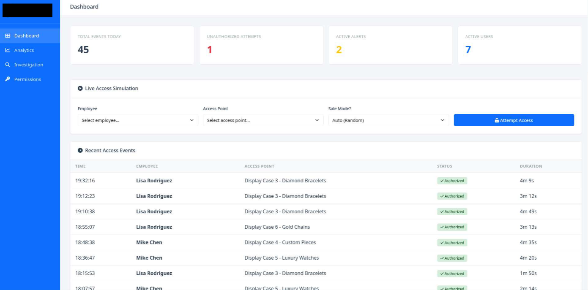

This is a **sample draft** to show how an article looks. It is marked `draft: true`, so it never appears on the live site. Delete this file when you write your first real post.

## A section heading

Paragraphs are plain text. You can add [links](https://emilianocar.com), *emphasis*, **strong text** and `inline code`. Straight "quotes" become curly ones automatically.

> A blockquote is for quoting another source.

{{pull: A pull quote sets one sentence from the piece large between paragraphs.}}

A margin note sits beside the text on wide screens. Use it for an aside or a source.{{note: Like this one. It drops in under the paragraph on a phone.}}

### A smaller heading

An unordered list:

- First point
- Second point with a little more text so you can see how longer items wrap on a narrow phone screen
- Third point

And a numbered one:

1. Do this first
2. Then this
3. Finally this

## Code

```python
def verify(chain):
    for prev, cur in zip(chain, chain[1:]):
        if cur.prev_hash != prev.hash:
            return False
    return True
```

## A table

| Tool | Used for | Notes |
|------|----------|-------|
| Python | Scripting | Quick one-off checks |
| SQL | Queries | Audit lookups |

## An image



---

That's everything. Text footnotes work too.[^1]

[^1]: Like this one, which collects at the bottom of the page.
